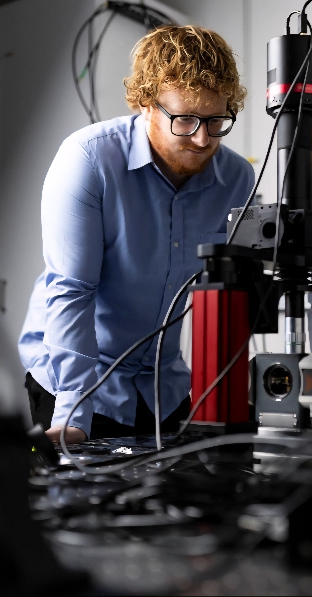

I am a Welsh-Australian researcher and educator, currently working as a Postdoctoral Research Fellow at the [University of Technology Sydney (UTS)](https://profiles.uts.edu.au/Chris.Bailey) in quantum spectroscopy and microscopy, as part of the Australian Research Council (ARC) Centre of Excellence in Quantum Biotechnology (QUBIC). My work brings together optical spectroscopy, microscopy, photonics and materials physics. My research interests include:

- optical microscopy and spectroscopy
- optoelectronic and photonic materials
- two-dimensional materials
- nanotechnology
- bio-inspired technologies
- quantum sensing and measurement

I specialise in experimental techniques spanning optical spectroscopy and microscopy, time-resolved optical and electrical measurements, magnetic resonance, and low-temperature measurements.

A large focus of my research has been on various forms of metal halide perovskite semiconductors, including nanomaterials (2D 'layered' perovskites, 1D nanowires, 0D quantum dots). 

I love teaching physics, photonics, and experimental methods, having contributed to over ten units of study across three world top-100 universities. I have an Associate Fellowship from Advance HE (AFHEA) in recognition of my teaching. I also mentor students and early-career researchers in many areas of study.

Outside my immediate research, I also like to follow progress in fundamental physics and have a general interest in biology.

Background
======
In 2015, I completed my Bachelors (BEng) in Electrical and Electronic Engineering from Cardiff University. 

In 2019, I obtained my PhD in Physics from the University of Southampton, which was funded by the EPSRC Centre for Doctoral Training in New and Sustainable Photovoltaics. The topic of my thesis was optical properties of perovskite materials for optoelectronics.

In 2020, I moved to Sydney, Australia to join the University of New South Wales (UNSW) as a Research Associate as part of the ARC Centre of Excellence in Exciton Science. Here, I worked on magnetic resonance techniques to study bio-inspired materials and exciton-spin properties of 2D materials.

In 2023, I was appointed Research Fellow at the University of Sydney. Here, I continued studies on the magneto-optical properties of excitons in 2D materials and characterisation of new technology for solar energy conversion. During this role, I worked with [EurokaPower](https://www.eurokapower.com/) on the integration of next-generation solar power for spacecraft.

In 2026, I joined UTS and QUBIC, where I investigate novel methods of quantum spectroscopy and microscopy including their biomedical applications.